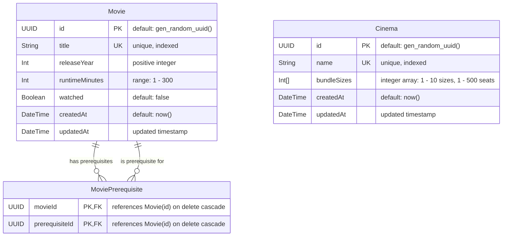

# Database Schema & Entity Relationships

This document outlines the PostgreSQL database schema for the **Doomsday Ready** application, managed through **Prisma ORM**.

---

## 1. Entity-Relationship Diagram (ERD)

---

## 2. Table Specifications

### 2.1 `Movie` Table
Stores Marvel Cinematic Universe movie records and their personal watch statuses.

| Column | Type | Nullable | Default | Description |
|---|---|---|---|---|
| `id` | `UUID` | No | `gen_random_uuid()` | Primary Key |
| `title` | `VARCHAR` | No | — | Unique movie title (trimmed, case-sensitive) |
| `releaseYear` | `INTEGER` | No | — | Positive integer (e.g. 2008) |
| `runtimeMinutes`| `INTEGER` | No | — | Movie duration in minutes (1–300) |
| `watched` | `BOOLEAN` | No | `false` | Whether the fan has watched this movie |
| `createdAt` | `TIMESTAMPTZ` | No | `now()` | Timestamp of record creation |
| `updatedAt` | `TIMESTAMPTZ` | No | `now()` | Automatically updated timestamp |

**Indexes & Constraints**:
- `PRIMARY KEY (id)`
- `UNIQUE INDEX (title)`
- `CHECK (runtimeMinutes >= 1 AND runtimeMinutes <= 300)`
- `CHECK (releaseYear > 0)`

---

### 2.2 `MoviePrerequisite` Table
A self-referencing many-to-many relationship join table representing directed dependency edges in the movie roadmap graph:
$$\text{movieId} \longrightarrow \text{prerequisiteId}$$
*(meaning: to watch `movieId`, `prerequisiteId` must be watched prior).*

| Column | Type | Nullable | Default | Description |
|---|---|---|---|---|
| `movieId` | `UUID` | No | — | FK referencing `Movie(id)` (the target/dependent movie) |
| `prerequisiteId` | `UUID` | No | — | FK referencing `Movie(id)` (the movie that must be watched first) |

**Indexes & Constraints**:
- Composite Primary Key: `PRIMARY KEY (movieId, prerequisiteId)` — prevents duplicate relationship edges between identical pairs.
- Foreign Key: `movieId REFERENCES Movie(id) ON DELETE CASCADE`
- Foreign Key: `prerequisiteId REFERENCES Movie(id) ON DELETE CASCADE`
- Performance Index: `INDEX (prerequisiteId)` — accelerates reverse dependent lookups during graph traversal.
- Application-Level Validation:
  - Disallows self-loops (`movieId === prerequisiteId`).
  - DFS graph cycle detection detects and rejects indirect circular paths before committing updates.

---

### 2.3 `Cinema` Table
Stores cinema locations and their available seat-bundle configurations.

| Column | Type | Nullable | Default | Description |
|---|---|---|---|---|
| `id` | `UUID` | No | `gen_random_uuid()` | Primary Key |
| `name` | `VARCHAR` | No | — | Unique cinema name (e.g. "Cinema A") |
| `bundleSizes` | `INTEGER[]` | No | — | Array of 1 to 10 distinct seat-bundle quantities (values 1–500) |
| `createdAt` | `TIMESTAMPTZ` | No | `now()` | Timestamp of record creation |
| `updatedAt` | `TIMESTAMPTZ` | No | `now()` | Automatically updated timestamp |

**Indexes & Constraints**:
- `PRIMARY KEY (id)`
- `UNIQUE INDEX (name)`
- Array constraints validated via NestJS DTO validation pipes:
  - Array length: 1 to 10 entries.
  - Unique elements: No duplicate bundle sizes allowed.
  - Value range: 1 to 500 for each bundle size.

---

## 3. Data Integrity & Transactions

1. **Atomic Graph Updates**: All updates altering a movie's prerequisites execute within a **Prisma database transaction** (`$transaction`). The proposed graph is inspected for circular dependencies prior to committing; any detected cycle aborts the transaction cleanly without leaving partial changes.
2. **Cascade Deletions**: In the event a movie record is deleted, related dependency edges in `MoviePrerequisite` are cleaned automatically through foreign key `CASCADE` rules.
3. **Strict Validation**: Both Prisma schema level constraints and NestJS class-validator pipes enforce data integrity prior to executing database queries.
